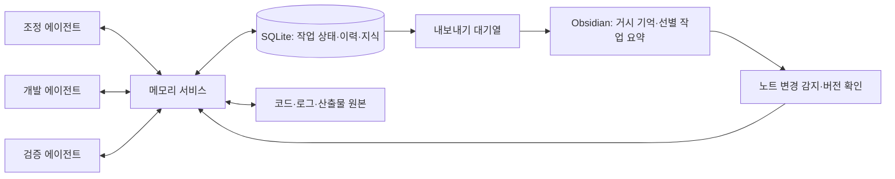

# Artemis 메모리 구조 조사 및 제안

조사일: 2026-10-28. 상태: **설계 후보이며, 사용자 확정이나 구현은 아직 없음.**

## 권장 방향

단일 컴퓨터에서 여러 에이전트를 실행하는 초기 환경을 가정하고, **중앙 메모리 서비스 + SQLite + 원본 산출물 저장소 + Obsidian 연결부**를 권장한다. 여러 컴퓨터에서 실행한다면 에이전트는 서비스 API로 접근하고, 실제 부하와 운영 요구에 따라 서버형 DB를 검토한다. SQLite 파일 자체를 네트워크로 공유하지 않는다.

중앙 메모리 서비스는 하네스 내부 모듈이나 로컬 프로세스로 시작할 수 있다. 독립 서버나 전담 LLM 에이전트가 반드시 필요한 것은 아니다. 모델은 기억 후보를 추출하고 요약하는 데 사용하며, 저장·범위 검사·버전 검사·중복 방지는 일반 코드로 처리한다.



이는 조사 자료를 바탕으로 한 Artemis용 제안이다. 특정 에이전트 프레임워크를 채택한다는 뜻은 아니다.

## 1. 기억을 역할별로 구분한다

| 종류 | 내용 | 기본 범위와 보관 위치 |
|------|------|----------------------|
| 작업 재개 상태 | 목표, 다음 행동, 막힌 점, 사용한 기억 버전, 처리 중인 도구 호출 ID | 에이전트 실행·작업별 체크포인트, DB |
| 작업 공유 상태 | 담당자, 의존 작업, 진행 상태, 결과 참조, 인계 내용 | 프로젝트·작업 범위, DB |
| 실행 이력 | 도구 요청과 결과, 파일 변경, 검증 실행, 오류와 해결 과정 | 사건 단위 기록은 DB, 큰 본문은 산출물 파일 |
| 재사용 지식 | 확인된 제약, 원인과 해결법, 환경별 주의점, 결정의 근거 | 프로젝트·컴포넌트 범위의 개별 기억, DB |
| 거시 기억 | 목표, 주요 결정, 구조 설명, 진행 개요, 장기 교훈 | Obsidian Markdown |

개인 작업 메모를 저장했다고 다른 에이전트에게 자동으로 공유되는 것은 아니다. `run-private`, `task-shared`, `project-shared`와 같은 명시적 범위를 두고, 서비스가 접근 범위를 검사한다. 다른 실행이 작업을 인계받으면 필요한 개인 상태를 인계 묶음으로 전환한다.

LangGraph도 작업 대화별 체크포인트와 대화 간 공유 저장소를 구분한다. 이 구분은 Artemis의 재개 상태와 공유 지식을 분리하는 설계 근거로 참고할 수 있다. [공식 Persistence 문서](https://docs.langchain.com/oss/python/langgraph/persistence)

## 2. 원본과 기억, 요약을 연결한다

예를 들어 개발 에이전트가 테스트 오류를 해결하면 다음 연결을 남긴다.

```text
도구 실행 ev-184 + 로그 artifact-52 + 변경 당시 코드 참조
    → 기억 mem-42: 특정 조건에서 발생한 오류와 확인된 해결법
    → 인계 handoff-17: 변경점·검증 범위·남은 일
    → Obsidian 작업 요약 note-12
    → Obsidian 구조 결정 note-03의 근거 링크
```

기억은 하나의 주장이나 경험 단위로 만든다. 사건 발생 시각, 기록 시각, 작성 주체, 원본 참조, 적용 범위와 검증 상태를 함께 저장한다. 코드 참조에는 저장소 ID, 커밋, 경로를 넣고, 미커밋 변경은 내용 해시와 필요한 스냅샷으로 식별한다. 같은 파일명이나 브랜치명만으로 당시 상태를 식별하지 않는다.

요약이 또 다른 요약을 인용하더라도 최초 근거 ID를 보존한다. 같은 근거를 여러 에이전트가 반복했다는 이유로 신뢰도를 높이지 않는다. 원본이 삭제·변경되거나 재현되지 않으면 그 상태를 표시한다.

저장 대상은 관찰 가능한 작업·결과와 명시적으로 작성한 설명이다. 모델의 내부 사고 과정을 보관하거나 복원한다는 전제는 두지 않는다. 인증 토큰과 비밀 값은 기억에 넣지 않으며, 로그 수집 시에도 제외한다.

## 3. 최소 데이터 구조

아래는 논리적 개체이며 최종 SQL 스키마가 아니다. 초기에는 일부를 합칠 수 있다.

| 개체 | 주요 필드와 역할 |
|------|------------------|
| `tasks` | 작업 ID, 목표, 담당 실행, 상태, 의존성, 버전 |
| `checkpoints` | 실행 ID, 작업 ID, 재개 요약, 마지막 처리 사건 번호, 진행 중 호출 참조 |
| `events` | 사건 ID, 작업·실행·주체 ID, 사건 유형, 발생·기록 시각, 작은 구조화 본문, 재시도 식별 키 |
| `artifacts` | 산출물 ID, 저장 위치, 내용 해시, 생성 실행, 보관·삭제 상태 |
| `memories` | 기억 ID, 종류, 본문, 범위, 작성 주체, 상태, 버전, 적용 코드·환경, 유효 기간 |
| `memory_sources` / `memory_links` | 기억과 원본의 연결, 대체·반박·관련 관계 |
| `note_bindings` | 고정 노트 ID, 현재 경로, 내용 해시, DB·내보내기 버전, 마지막 연결 상태 |
| `outbox` | DB 반영 후 실행할 노트 생성·색인 작업, 재시도와 완료 상태 |

기억의 `kind`는 `observation`, `hypothesis`, `decision`, `procedure` 등을 구분한다. `status`는 `proposed`, `validated`, `accepted`, `disputed`, `superseded`, `stale` 등을 구분한다. 테스트로 검증한 관찰과 사용자가 채택한 설계 결정은 검증 방식이 다르다. 단일 confidence 점수로 대체하지 않는다.

예시 기억은 다음 정보를 가진다.

```yaml
id: mem-42
project_id: artemis
task_id: task-17
scope: project-shared
kind: observation
status: validated
subject: component-x/retry-behavior
summary: "조건 X에서 오류 Y가 발생했으며 변경 Z 후 지정 검증이 통과했다."
source_ids: [ev-184, artifact-52]
validated_by: ev-191
repo_id: repo-01
commit: "<검증한 커밋>"
environment: "<검증한 환경>"
revision: 1
```

`validated`는 해당 근거·조건에서 확인했다는 의미다. 모든 브랜치와 환경에서 유효하다는 의미는 아니다.

## 4. 에이전트가 읽고 공유하는 흐름

1. 작업 시작 시 현재 목표·제약, 해당 작업 공유 상태, 적용 가능한 거시 결정, 관련 기억을 묶어 제공한다. 전체 대화를 매번 주입하지 않는다.
2. 실행 중 중요한 도구 결과와 작업 전환을 구조화 사건으로 기록한다. 토큰 스트림 전체를 DB 사건으로 저장하지 않는다. 큰 로그는 별도 파일로 보관한다.
3. 발견 사항은 기억 후보로 제출하고, 서비스가 범위·중복·근거를 검사한다. 후보를 읽을 때도 미검증 상태를 드러낸다.
4. 검증 결과를 근거에 연결하고, 작업 종료·실패·인계 또는 컨텍스트 압축 전에 체크포인트와 인계를 저장한다.
5. 관련 작업을 구독한 에이전트에게 새 기억 ID와 버전만 알린다. 에이전트는 다음 행동 전에 필요한 내용을 읽는다.

다른 에이전트의 프롬프트가 기록 즉시 바뀌는 구조는 아니다. 쓰기 응답으로 반영된 사건 번호를 반환하고, 읽기는 특정 번호 이후의 변경을 요청할 수 있게 한다. 중요한 결정이 바뀌면 조정 계층이 진행 중 작업을 재검토하거나 중단할지 정한다.

최소 도구 표면은 `get_task_context`, `record_event`, `propose_memory`, `search_memory`, `get_evidence`, `save_handoff` 정도로 시작할 수 있다. 상태 전이와 권한 검사는 서비스가 담당한다. 특정 Codex 세션의 대화 이력을 공유 메모리의 유일한 저장소로 삼지 않아 연결 방식 변경에도 유지되도록 한다.

체크포인트는 재개에 필요한 외부 상태를 보존한다. 이미 실행한 파일 변경이나 외부 호출을 자동으로 반복하면 안 된다. 도구 호출 ID와 실제 결과를 대조하고 불명확한 작업은 복구 절차로 넘긴다. 메모리만으로 정확히 한 번 실행을 보장하지 않는다.

## 5. 충돌과 낡은 기억을 처리한다

- **동시 수정:** 현재 버전을 지정한 변경만 반영한다. 버전이 다르면 다시 읽고 조정한다. 여러 에이전트가 마지막 저장 내용으로 덮어쓰지 않게 한다.
- **재전송:** 사건별 재시도 키에 고유 제약을 두어 같은 도구 결과를 중복 반영하지 않는다.
- **다른 주장:** 동일 주제·범위에 모순된 기억이 생기면 둘 다 근거와 함께 남기고 `disputed`로 표시한다. 최신 시각만으로 정답을 고르지 않는다.
- **결정 변경:** 새로 채택한 결정이 이전 결정을 `superseded`로 대체한다. 과거 이유는 이력으로 보관하고 기본 검색에서는 제외한다. 초안 노트나 모델 제안은 채택된 결정으로 자동 승격하지 않는다.
- **코드 변경:** 관련 파일·환경이 바뀌면 검증 기억을 재검토 대상으로 둔다. 다른 작업 트리에서 통과한 테스트를 현재 코드의 통과 근거로 사용하지 않는다.
- **근거의 권위:** 제품 요구는 사용자의 명시적 지시와 채택된 결정으로 판단하고, 코드 동작은 해당 버전의 코드·검증 결과로 판단한다. 기억 전체에 하나의 단순 우선순위를 적용하지 않는다.

사건 이력은 보관 기간 내에서 덧붙이는 방식으로 유지하되 개인정보·비밀 제거와 명시적 삭제는 지원한다. 교체된 기억과 일시 로그의 보관 기간을 구분한다. 삭제는 색인과 파생 요약까지 추적하고, 근거가 제거된 요약을 그대로 검증된 사실로 제공하지 않는다.

## 6. Obsidian과 연결하는 방식

Obsidian은 로컬 폴더의 Markdown 파일을 저장하고 외부 파일 변경을 반영한다. 따라서 초기 연결은 파일 읽기·쓰기와 변경 감지로 시작할 수 있다. 전용 플러그인은 필수 조건이 아니다. [공식 저장 방식](https://obsidian.md/help/data-storage)

논리적인 노트 구획 예시는 다음과 같다. 실제 Vault 위치나 폴더는 아직 만들지 않는다.

```text
Artemis/
  Overview.md
  Decisions/       # 사람이 관리하는 채택 결정과 결정 초안
  Architecture/    # 사람이 관리하는 구조 설명
  Lessons/         # 사람이 관리하는 장기 교훈
  Generated/
    Tasks/         # 작업 종료 시 생성하는 선별 요약
    Evidence/      # 필요한 근거만 사람이 읽을 수 있게 내보낸 문서
```

소유권은 다음처럼 나눈다.

| 대상 | 원본으로 취급할 위치 | 반대 방향 반영 |
|------|--------------------|----------------|
| 사람이 관리하는 거시 노트 | Obsidian Markdown | 변경 버전을 DB에 읽기용 색인으로 반영 |
| 작업 상태·실행 이력·세부 기억 | DB와 산출물 | 선택한 요약·근거를 Obsidian으로 내보내기 |
| 자동 생성 노트 | DB에서 만든 파생 문서 | 사람이 수정하면 변경으로 감지하고 재생성을 멈추거나 새 버전 파일로 출력 |

노트에는 평평한 Properties로 `artemis_id`, `project_id`, `kind`, `status`, `source_ids`, `revision` 등을 둔다. 경로가 바뀌어도 `artemis_id`로 연결한다. 여러 근거는 List 속성으로 표현하고 복잡한 근거 상세는 본문에 둔다. Obsidian은 YAML Properties와 내부 링크를 지원한다. [Properties](https://obsidian.md/help/properties), [내부 링크](https://obsidian.md/help/links)

거시 노트 본문은 작업 요약과 근거 문서에 링크하고, DB는 노트 ID·현재 경로·버전을 역으로 보관한다. DB 내부 ID는 해석기가 있어야 조회할 수 있으므로, 실제로 열 수 있는 Markdown 링크와 구분한다. 원시 로그를 Vault에 전부 복사하지 않는다.

DB와 Markdown을 하나의 트랜잭션으로 저장할 수 없으므로, DB 변경과 내보내기 대기열을 함께 커밋하고 연결부가 재시도 가능하게 파일을 출력한다. 내보낸 버전을 기록하고 재시작 후 미완료 항목을 처리한다. 검색 결과에는 거시 노트 색인이 어느 버전인지 표시한다.

사람 소유 노트는 자동으로 덮어쓰지 않고 수정 제안을 별도 노트로 만든다. 자동 생성 노트도 원본 해시와 다르면 충돌로 다룬다. 파일 해시 확인과 원자적 교체만으로 Obsidian 편집기와의 동시 수정을 완전히 막을 수는 없다. 초기 구현은 불변 버전 파일 출력과 이전 버전 보존을 우선해 변경 유실을 피한다. 동일 노트 자동 병합은 후속 검토 대상이다.

거시 기억으로 올릴 기준은 주요 설계 결정, 장기 제약, 재발 가능한 교훈, 마일스톤이다. 작업 요약 생성과 제품 결정의 채택은 별개다. 사람이 거시 노트를 고치면 연결부가 새 버전을 읽고 관련 작업에 변경을 알리되, 초안은 초안 상태로 유지한다.

## 7. 검색은 범위와 버전부터 좁힌다

1. 프로젝트·접근 범위·작업·저장소·적용 버전을 먼저 제한한다.
2. 현재 목표·제약·채택된 거시 결정·진행 중 공유 상태를 별도 필수 항목으로 확보한다.
3. 파일 경로·기호명·기억 ID의 정확 검색과 전문 검색으로 관련 경험을 찾는다.
4. 근거가 있는 기억을 우선하고 유사한 중복은 묶는다. 필요하면 원본으로 내려간다.
5. 정해진 컨텍스트 예산 안에서 요약, 상태, 범위, 근거 링크를 제공한다. 예산과 건수는 실제 평가로 정한다.

초기에는 SQLite의 구조화 조회와 FTS5 전문 검색을 제안한다. FTS5는 전문 검색과 trigram 부분 문자열 검색을 지원한다. [공식 FTS5 문서](https://www.sqlite.org/fts5.html)

한국어 조사·띄어쓰기와 코드 기호의 검색은 별도 평가가 필요하다. 기본 토크나이저를 한국어 형태소 분석기로 간주하지 않는다. trigram은 3글자 미만 전문 검색에 제약이 있으므로 짧은 용어는 별칭·정확 조회 등으로 보완한다. 이후 한국어·영어 표현 차이와 의미가 비슷한 경험을 놓치는 문제가 확인되면 임베딩 검색을 추가하고 정확·전문 검색과 결합한다. 임베딩은 검색 색인이며 근거 원본을 대체하지 않는다.

## 8. 선택지 비교와 운영 범위

| 선택지 | 장점 | Artemis에서의 판단 |
|--------|------|-------------------|
| Markdown만 사용 | 읽기·수정·Git 비교가 쉬움 | 거시 기억에 적합. 동시 상태 변경과 세부 기록에는 별도 프로토콜이 필요 |
| SQLite + 산출물 + Obsidian | 상태·버전·근거 조회와 사람이 읽는 문서를 함께 관리 가능 | 단일 호스트 초기 구성을 위한 권장안 |
| 벡터 DB 중심 | 표현이 다른 유사 내용 검색에 활용 가능 | 작업 상태·정확한 버전·근거 관리와 별도. 필요를 확인한 뒤 색인으로 추가 |
| 그래프 DB 중심 | 복잡한 관계 탐색에 활용 가능 | 우선 관계 테이블과 노트 링크로 시작하고, 다단계 관계 조회가 병목이면 재검토 |

SQLite WAL은 읽기와 쓰기를 함께 진행할 수 있지만 쓰기는 한 번에 하나이며, 네트워크 파일시스템에서는 사용할 수 없다. 중앙 서비스가 짧은 쓰기를 순서대로 처리하고, 장기 LLM 요청 중에는 DB 트랜잭션을 잡지 않는다. [공식 WAL 문서](https://www.sqlite.org/wal.html)

라이브 DB는 Obsidian Vault 동기화 대상에서 분리한다. 여러 장치에는 서비스 API 또는 일관된 백업을 사용한다. SQLite Online Backup API는 실행 중 DB의 스냅샷 백업을 지원한다. DB 백업과 참조 산출물을 함께 보관해야 하며, Obsidian 요약만으로 전체 작업 상태를 복구할 수는 없다. [공식 Backup API](https://www.sqlite.org/backup.html)

## 9. 첫 검증 범위

구현을 시작할 때는 2~3개 역할의 에이전트가 작은 개발 작업을 분담하는 시나리오로 검증한다. 역할 수와 기술 스택은 아직 확정하지 않는다.

| 상황 | 확인할 결과 |
|------|-------------|
| A가 발견한 오류를 B가 수정 | B가 관련 기억과 원본을 찾고 적용 조건을 확인 |
| B 수정 후 C가 검증 | 테스트가 실행된 코드 버전과 결과가 기억에 연결됨 |
| 프로세스 재시작·컨텍스트 압축 | 완료한 행동을 반복하지 않고 남은 작업과 근거를 복원 |
| 같은 사건 재전송·같은 기억 동시 수정 | 중복 기록과 조용한 덮어쓰기 방지 |
| 서로 다른 브랜치의 결과 | 현재 작업에 맞지 않는 검증 결과를 명시적으로 구분 |
| 결정이 변경되거나 주장이 충돌 | 기본 조회에서 현재 결정과 미해결 충돌을 올바르게 표시 |
| 사람이 노트를 이동·수정 | 노트 ID를 유지하고 변경 내용을 덮어쓰지 않음 |
| DB 커밋 후 노트 출력 전 종료 | 재시작 후 내보내기를 복구하며 중복 노트를 방지 |
| 한국어 질문·짧은 기호 검색 | 필요한 기억 누락과 불필요한 검색 결과를 측정 |
| 근거 삭제·보관 기간 만료 | 파생 색인과 요약의 근거 상태도 갱신 |

평가 항목은 관련 기억 회수율, 오래된 기억의 잘못된 사용, 근거 추적 가능 여부, 인계 성공률, 컨텍스트 사용량과 응답 지연이다. 아직 성능 수치나 정확도 목표를 확정하지 않았다.

다음 결정은 **실행 환경이 단일 호스트인지**, **거시 노트 중 사람이 관리할 범위**, **자동 공유·검증·결정 채택의 경계**다. 이후 작은 시나리오로 저장·인계·Obsidian 연결을 검증한 뒤 임베딩이나 별도 메모리 프레임워크의 필요성을 판단한다.
