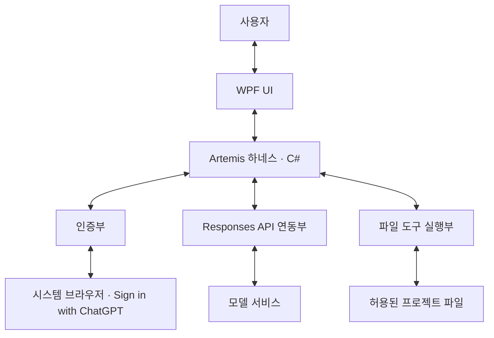

# Artemis 1차 마일스톤 설계 기획서

작성일: 2026-10-28

대상: Windows 데스크톱 하네스 기반

상태: **확정 요구사항을 반영한 설계 기획서. 애플리케이션 구현·실제 연결 검증 전.**

## 1. 목적

사용자가 Artemis에서 ChatGPT 계정으로 인증하고, 모델과 대화하며, 프로젝트 파일 도구를 사용하는 데스크톱 하네스의 기반을 설계한다.

핵심 확인 흐름은 **인증 → 요청 → 모델 응답·도구 요청 → 허용 범위 검사·필요한 사용자 확인 → 실행 → 결과 반환·답변 표시**다. 여기서 답변 확인은 정상 수신·표시와 완료 여부를 확인하는 기능이다. 답변 내용의 정답 여부를 자동 판정하는 별도 시스템은 포함하지 않는다.

이 문서는 사용자가 확정한 요구사항과 이를 연결하는 설계안을 정리한다. 구현은 별도 지시에 따른다. 제시하지 않은 후속 마일스톤은 정의하지 않는다.

## 2. 확정 사항

| 항목 | 확정 내용 |
|------|-----------|
| 운영 환경·기술 | 로컬 Windows 데스크톱, **.NET + WPF + C#** |
| 인증 | **Artemis가 직접 관리하는 Sign in with ChatGPT**, 시스템 브라우저 이용 |
| 실행 엔진 | **Responses API 직접 연동** |
| 중심 모델 | **`gpt-6.1-sol`** |
| 보조·간단한 작업용 모델 | **`gpt-6.1-terra`** |
| 최초 지원 도구 | 파일 목록·텍스트 읽기·검색·텍스트 생성·수정 **B안** |
| 도구 실행 범위 | 사용자가 선택한 프로젝트 루트 내부의 허용된 경로·텍스트 파일 |
| 목록·읽기·검색 | 사용자 요청·허용 범위 안에서 **자동 진행** |
| 생성·수정 | **한 파일의 대상·변경 내용을 확인받은 뒤 실행** |
| 자율성 | 사용자 지시 범위를 넘는 행동 금지, 필요한 사용자 판단 반영 |
| 재시도·실행 한도 | 재시도 최대 **5회**, 작업 시간·사용량 제한 없음 |

사용자에게 인증을 위한 Codex나 별도 앱 설치를 요구하지 않는다. Codex app-server·Codex SDK는 채택하지 않으며 Codex 런타임의 설치·동봉을 전제로 하지 않는다. 로컬 운영은 앱과 하네스의 실행 위치를 뜻하며, 인증·원격 모델 호출에는 네트워크가 필요하다.

## 3. 기능 범위

| 기능 | 이번 설계의 범위 |
|------|------------------|
| 작업 대상 지정 | 프로젝트 루트 선택과 현재 허용·제외 범위 표시 |
| 인증 | 로그인 시작, 브라우저 인증 결과, 연결 상태, 연결 해제, 인증 오류 처리 |
| 모델 요청·대화 | 지정 모델로 요청, 스트리밍·최종 응답 표시, 후속 질문의 맥락 유지 |
| 파일 도구 | 목록·읽기·검색과 확인을 거친 텍스트 생성·수정 |
| 사용자 제어 | 변경 내용 허용·거부, 중단 요청, 상태·오류·재시도 횟수 확인 |
| 결과 확인 | 실행한 도구와 실제 결과, 반영한 파일 변경, 최종 답변 확인 |

**단일 대화에서 위 기능을 연결하는 것을 이번 설계의 기준안으로 둔다.** 대화 수·영속 저장·복원 방식은 확정하지 않았다. 멀티 에이전트 협업과 Obsidian 메모리는 전체 MVP 목표로 유지하며 이번 기반 흐름의 설계와 구분한다.

파일·폴더 삭제·이동, 터미널 명령, Git 커밋·푸시, 패키지 설치, 도구를 통한 웹·외부 서비스 작업은 최초 도구 범위에 포함하지 않는다. 이 도구 구성만으로 빌드·테스트 실행이나 변경 코드의 동작 검증까지 제공하지 않는다.

## 4. 구성 요소와 책임

| 구성 요소 | 책임 |
|-----------|------|
| WPF UI | 요청·사용자 판단을 받고 연결·응답·도구·변경·실행 상태 표시 |
| 하네스 | 요청과 대화 맥락 관리, 모델·도구 실행 연결, 범위·확인 정책 적용, 상태 전달 |
| 인증부 | OAuth 시작·콜백·토큰 검증·보관·갱신·연결 해제 관리 |
| Responses API 연동부 | 선택 모델 호출, 응답·도구 요청 수신, 실제 도구 결과 반환과 후속 요청 |
| 파일 도구 실행부 | 도구명·입력·경로·권한 검사, 허용된 작업 실행, 결과·오류 반환 |

이는 기능별 책임 구분이며 프로젝트 구조·클래스·프로세스 분리를 확정하는 설계는 아니다. 토큰 저장 기술과 대화·실행 기록 저장 방식은 미정이다.

## 5. 화면 기능 설계

아래는 필요한 정보와 조작의 구성안이다. 실제 화면 배치·스타일은 후속 설계에서 정한다.

| 영역 | 표시 정보 | 사용자 조작 |
|------|-----------|-------------|
| 프로젝트·범위 | 현재 루트, 읽기·쓰기 허용 범위, 제외 대상, 읽은 내용의 모델 전달 안내 | 작업 폴더 선택 |
| 연결·모델 | 로그인 상태, 선택 모델, 연결·인증 오류 | 로그인·연결 해제, 모델 선택 |
| 대화 | 사용자 요청, 진행 중 응답, 최종 답변 | 입력·전송, 후속 질문 |
| 도구·변경 확인 | 도구명, 대상 경로, 입력 요약, 생성 내용·수정 차이, 실행 결과·오류 | 생성·수정 허용 또는 거부 |
| 실행 상태 | 실행·확인 대기·완료·실패·중단, 재시도 횟수 | 중단 요청, 재시도 조작 방식은 미정 |

파일 생성은 생성할 내용을, 수정은 변경 전후 차이를 확인할 수 있어야 한다. 확인 대기 중 실제 파일은 변경하지 않는다. 자동 실행한 목록·읽기·검색도 실행 내역과 결과를 확인할 수 있게 한다.

## 6. 기본 동작 흐름

### 6.1 인증과 요청

1. 사용자가 Artemis에서 로그인을 시작한다.
2. 인증부가 시스템 브라우저 인증을 연결하고 성공·취소·실패 결과를 UI에 전달한다.
3. 사용자가 작업할 프로젝트 루트와 모델을 확인하고 요청을 전송한다.
4. 하네스가 대화 맥락·허용 도구와 함께 Responses API를 호출한다.
5. 응답 진행을 표시하고 일반 답변과 도구 요청을 구분해 처리한다.

두 모델의 용도는 확정했지만 자동 작업 분류·모델 전환·에이전트별 세부 배정은 정하지 않았다. 모델 접근 가능 여부는 목록 표시가 아닌 각 모델의 실제 호출 정상 완료로 확인한다.

### 6.2 목록·읽기·검색

1. 모델의 도구 요청을 받아 도구명·입력·경로와 사용자 요청 범위를 검사한다.
2. 허용된 목록·읽기·검색을 별도 확인 없이 실행한다.
3. 도구 호출 ID에 대응하는 실제 결과 또는 오류를 반환한다.
4. 하네스가 결과를 모델에 전달하고 후속 답변이나 추가 도구 요청을 처리한다.

### 6.3 파일 생성·수정

1. 도구 요청의 대상·입력·허용 범위를 검사한다.
2. 한 파일의 대상 경로와 생성 내용 또는 수정 차이를 표시한다.
3. 사용자가 허용하면 적용 직전 경로·권한·파일 상태를 다시 검사한다. 거부한 변경은 실행하지 않는다.
4. 확인 이후 파일이 변경됐으면 덮어쓰지 않고 충돌을 표시한다.
5. 허용된 변경을 반영하고 다시 읽어 실제 결과를 확인한다.
6. 실제 반영 결과 또는 오류를 모델에 반환하고 답변으로 연결한다.

확인은 표시한 파일·변경에 대한 것이다. 이후 다른 변경까지 포괄 승인된 것으로 처리하지 않는다.

## 7. 파일 도구와 허용 범위

기능은 아래 4종으로 확정했다. **함수명은 설명용 초안이며 입력·출력 계약은 미정**이다.

| 도구명 초안 | 기능·반환 정보 | 실행 확인 |
|-------------|----------------|-----------|
| `list_files` | 허용 경로의 폴더·파일 목록 | 자동 |
| `read_text_file` | 텍스트의 지정 부분, 행 범위·잘림 여부 | 자동 |
| `search_text` | 허용된 텍스트의 일치 내용·경로·행 번호 | 자동 |
| `write_text_file` | 한 텍스트 파일의 생성·수정, 실제 반영 결과 | 변경 내용 확인 후 실행 |

허용 범위는 모든 파일 도구에 공통으로 적용한다.

- 사용자가 선택한 프로젝트 루트 내부와 사용자 요청 대상만 다룬다. 모델이 루트·권한을 스스로 확대하지 못하게 한다.
- 상위 경로 이동이나 심볼릭 링크·Windows junction 등을 통해 실제 대상이 루트 밖으로 나가는 접근도 거부한다.
- `.git`, `.env`, 자격 증명·개인 키 등 비밀 파일과 바이너리를 제외한다. `.gitignore`만으로 접근 제어를 대신하지 않는다.
- 검색도 읽기가 허용된 파일만 대상으로 한다. 읽기·검색 결과는 모델에 전달되므로 범위와 제외 대상을 UI에 알린다.
- 파일 내용이나 모델의 도구 요청을 사용자의 권한 확대 지시로 취급하지 않는다.
- 제외한 작업은 사용자 확인만으로 실행 가능해지는 도구로 노출하지 않는다. 인증·모델 호출에 필요한 통신과 파일 도구의 외부 접근은 구분한다.

## 8. 상태·오류·중단 설계

다음은 UI 표시를 위한 상태안이다. 요청의 응답 완료와 전체 제품의 작업 목표 달성 판단은 구분한다.

| 상태 | 표시 의미 |
|------|-----------|
| 대기 | 요청을 실행하지 않는 상태 |
| 실행 | 모델 응답 수신 또는 허용된 도구 실행 중 |
| 사용자 확인 대기 | 생성·수정 내용을 표시하고 허용·거부를 기다림 |
| 완료 | 해당 요청의 최종 응답을 정상 수신한 상태 |
| 실패 | 인증·통신·응답 처리 등의 오류로 요청이 정상 완료되지 않음 |
| 중단 | 사용자가 중단한 요청이며 정상 완료와 구분 |

로그인 상태와 개별 도구 결과는 요청 상태와 함께 표시한다. 도구의 거부·취소·오류·충돌을 성공으로 기록하지 않으며, 도구 결과를 확인하지 않고 모델의 설명만으로 실행 성공을 판단하지 않는다. 개별 도구 오류 이후 요청을 계속할지 종료할지의 상세 정책은 미정이다.

- 일부 답변이 표시됐어도 통신 실패·중단을 정상 완료로 표시하지 않는다.
- 중단 요청 뒤 새로운 모델 요청이나 도구 실행을 시작하지 않는다. 진행 중 실행·쓰기의 중단 처리와 반영 결과 확인·복구 방식은 후속 설계에서 정한다.
- 재시도는 최대 5회이며 작업 시간·사용량 제한은 두지 않는다. 카운트 적용 단위와 자동·수동 여부는 미정이다.
- 쓰기 결과가 불명확하면 같은 변경을 자동 반복하지 않는다.

## 9. 연동 시 준수할 사항

Artemis가 function 도구를 제공하고 호출 ID에 맞춰 실행 결과를 모델에 반환한다. 입력 형식 검사와 실제 경로·권한 검사를 구분한다. `strict: true` 사용은 입력 스키마 준수를 위한 기존 설계 제안이며 최종 함수 계약에서 정한다. [공식 function calling 문서](https://developers.openai.com/api/docs/guides/function-calling).

선택한 Sign in with ChatGPT 경로의 도구는 function/custom 도구를 namespace로 묶거나 `additional_tools` 입력으로 제공하는 요구사항을 따른다. 로컬 `search_text`는 호스팅 `file_search`와 구분한다. 호스팅 MCP·Code Interpreter·네이티브 computer use 등 이 경로의 미지원 도구를 전제로 설계하지 않는다. [공식 프리뷰 제약](https://developers.openai.com/siwc/token-sharing-open-source/preview-limitations).

OAuth 등록·토큰 검증·갱신은 선택한 Sign in with ChatGPT 경로에 맞춰 설계한다. 배포 형태에 맞는 경로 적용 조건과 계정별 사용 가능 여부도 구현 시 확인한다. [공식 등록·로그인 문서](https://developers.openai.com/siwc/token-sharing-open-source/sign-in).

위 자료는 기존 공식 문서 조사에 근거한 참고이며 Artemis의 연결 성공을 의미하지 않는다.

## 10. 구현 후 확인 시나리오

아래는 향후 기능 검증 기준이다. 현재 실행한 테스트 결과나 전체 제품의 완료·중단 정책 확정 사항이 아니다.

| ID | 시나리오 | 확인 기준 |
|----|----------|-----------|
| M1-01 | Codex 미설치 환경의 인증 | Artemis에서 브라우저 인증을 시작·완료하며 별도 인증 앱 설치를 요구하지 않음 |
| M1-02 | 로그인·취소·실패·연결 해제 | 상태가 구분되고 오류 원인·다음 행동을 확인할 수 있음 |
| M1-03 | 두 모델의 요청과 후속 질문 | `gpt-6.1-sol`·`gpt-6.1-terra` 각각 정상 응답을 표시하고 대화 맥락이 이어짐 |
| M1-04 | 스트리밍·실패·중단 | 일부 출력과 최종 응답을 구분하고 실패·중단을 정상 완료로 표시하지 않음 |
| M1-05 | 목록 → 검색 → 읽기 → 답변 | 허용 범위 안에서 매번 확인 없이 실행하고 실제 파일 결과가 모델 답변에 연결됨 |
| M1-06 | 텍스트 생성·수정 | 허용 전 파일 미변경, 변경 확인·허용 후 실제 반영, 다시 읽은 결과를 모델에 반환 |
| M1-07 | 생성·수정 거부 | 거부한 변경이 실제 파일에 반영되지 않음 |
| M1-08 | 범위 밖·제외 대상·미지원 작업 | 외부 경로와 링크 우회, 비밀 파일·바이너리, 제외 기능이 실행되지 않음 |
| M1-09 | 확인 이후 파일 변경 | 기존 확인으로 덮어쓰지 않고 충돌을 표시함 |
| M1-10 | 잘못된 입력·도구 실행 오류 | 오류를 표시하고 대응하는 도구 결과로 반환하며 성공으로 기록하지 않음 |
| M1-11 | 두 모델의 도구 호출 | 각 모델에서 실제 도구 요청 → 실행 → 결과 반환 → 후속 답변을 확인함 |
| M1-12 | 사용자 중단 | 중단 요청 뒤 새로운 모델 요청·도구 실행을 시작하지 않음 |
| M1-13 | 재시도 한도 | 적용 단위 확정 후 해당 단위의 5회 한도를 확인하며 불명확한 쓰기를 자동 반복하지 않음 |

## 11. 남은 설계 결정

- .NET 대상 버전, 화면 배치와 변경 확인 UI의 세부 구성.
- OAuth 등록·토큰 저장·갱신·연결 해제의 상세 절차와 오류 대응.
- 단일 대화 기준안의 확정, 대화·실행 기록의 저장·복원 범위와 방식.
- 확정 모델의 UI 선택 방식, 작업 분류·모델 전환 기준·에이전트별 세부 배정.
- 도구의 최종 함수명, 입력·출력 계약, 파일 형식·인코딩과 비밀 파일 식별 기준 등 실행 세부 규칙.
- 재시도 카운트 단위·자동/수동 여부, 개별 도구 오류 이후 처리, 진행 중 실행의 중단·결과 확인·복구 방식.
- 전체 작업의 완료·중단 판단 기준.

## 12. 현재 산출물·검증 상태

이 문서의 산출물은 **확정 요구사항, 기능 범위, 구성 요소별 책임, 화면 기능안, 동작 흐름, 도구 정책, 상태·오류 처리안과 구현 후 확인 시나리오**다.

현재 애플리케이션 코드·의존성·실행 명령·테스트는 없다. OAuth 인증, 모델 접근·추론, 도구 실행과 성능을 검증하지 않았다. 문서 검사는 애플리케이션 기능 검증을 대체하지 않는다.
