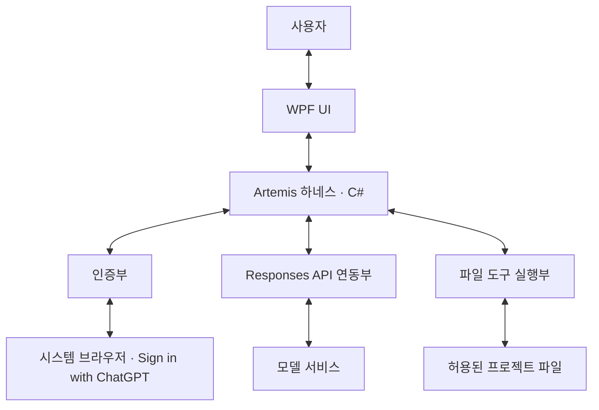

# Artemis 1차 마일스톤 설계 기획서

작성일: 2026-10-28

대상: Windows 데스크톱 하네스 기반

상태: **Milestone 1 초기 구현 추가, Release 빌드·오프라인 회귀 검증 통과. 기본 미로그인 UI 확인 완료, 실제 계정 연결과 로그인 이후 UI는 미검증이며 마일스톤 전체 완료는 아님.**

## 1. 목적

사용자가 Artemis에서 ChatGPT 계정으로 인증하고, 모델과 대화하며, 프로젝트 파일 도구를 사용하는 데스크톱 하네스의 기반을 설계한다.

핵심 확인 흐름은 **인증 → 요청 → 모델 응답·도구 요청 → 허용 범위 검사·필요한 사용자 확인 → 실행 → 결과 반환·답변 표시**다. 여기서 답변 확인은 정상 수신·표시와 완료 여부를 확인하는 기능이다. 답변 내용의 정답 여부를 자동 판정하는 별도 시스템은 포함하지 않는다.

이 문서는 확정 요구사항과 설계안을 정리하고, 2026-10-28 사용자의 구현 시작 지시에 따른 초기 구현·검증 상태를 함께 기록한다. 초기 구현에서 채운 세부 사항은 12절에 구분한다. 제시하지 않은 후속 마일스톤은 정의하지 않는다.

## 2. 확정 사항

| 항목 | 확정 내용 |
|------|-----------|
| 운영 환경·기술 | 로컬 Windows 데스크톱, **.NET + WPF + C#** |
| 인증 | **Artemis가 직접 관리하는 Sign in with ChatGPT**, 시스템 브라우저 이용 |
| 실행 엔진 | **Responses API 직접 연동** |
| 중심 모델 | **`gpt-6.1-sol`** |
| 보조·간단한 작업용 모델 | **`gpt-6.1-terra`** |
| 최초 지원 도구 | 파일 목록·텍스트 읽기·검색·텍스트 생성·수정 **B안** |
| 도구 실행 범위 | 사용자가 선택한 프로젝트 루트 내부의 허용된 경로·텍스트 파일 |
| 목록·읽기·검색 | 사용자 요청·허용 범위 안에서 **자동 진행** |
| 생성·수정 | **한 파일의 대상·변경 내용을 확인받은 뒤 실행** |
| 자율성 | 사용자 지시 범위를 넘는 행동 금지, 필요한 사용자 판단 반영 |
| 재시도·실행 한도 | 재시도 최대 **5회**, 작업 시간·사용량 제한 없음 |

사용자에게 인증을 위한 Codex나 별도 앱 설치를 요구하지 않는다. Codex app-server·Codex SDK는 채택하지 않으며 Codex 런타임의 설치·동봉을 전제로 하지 않는다. 로컬 운영은 앱과 하네스의 실행 위치를 뜻하며, 인증·원격 모델 호출에는 네트워크가 필요하다.

## 3. 기능 범위

| 기능 | 이번 설계의 범위 |
|------|------------------|
| 작업 대상 지정 | 프로젝트 루트 선택과 현재 허용·제외 범위 표시 |
| 인증 | 로그인 시작, 브라우저 인증 결과, 연결 상태, 연결 해제, 인증 오류 처리 |
| 모델 요청·대화 | 지정 모델로 요청, 스트리밍·최종 응답 표시, 후속 질문의 맥락 유지 |
| 파일 도구 | 목록·읽기·검색과 확인을 거친 텍스트 생성·수정 |
| 사용자 제어 | 변경 내용 허용·거부, 중단 요청, 상태·오류·재시도 횟수 확인 |
| 결과 확인 | 실행한 도구와 실제 결과, 반영한 파일 변경, 최종 답변 확인 |

**초기 구현은 단일 메모리 대화에서 위 기능을 연결한다.** 영속 저장·복원은 구현하지 않았으며 향후 정책은 미정이다. 멀티 에이전트 협업과 Obsidian 메모리는 전체 MVP 목표로 유지하며 이번 기반 흐름의 설계와 구분한다.

파일·폴더 삭제·이동, 터미널 명령, Git 커밋·푸시, 패키지 설치, 도구를 통한 웹·외부 서비스 작업은 최초 도구 범위에 포함하지 않는다. 이 도구 구성만으로 빌드·테스트 실행이나 변경 코드의 동작 검증까지 제공하지 않는다.

## 4. 구성 요소와 책임

| 구성 요소 | 책임 |
|-----------|------|
| WPF UI | 요청·사용자 판단을 받고 연결·응답·도구·변경·실행 상태 표시 |
| 하네스 | 요청과 대화 맥락 관리, 모델·도구 실행 연결, 범위·확인 정책 적용, 상태 전달 |
| 인증부 | OAuth 시작·콜백·토큰 검증·보관·갱신·연결 해제 관리 |
| Responses API 연동부 | 선택 모델 호출, 응답·도구 요청 수신, 실제 도구 결과 반환과 후속 요청 |
| 파일 도구 실행부 | 도구명·입력·경로·권한 검사, 허용된 작업 실행, 결과·오류 반환 |

초기 코드는 Core와 Desktop 프로젝트로 책임을 나누고, 토큰은 Windows DPAPI 저장소를 사용한다. 대화·실행 기록은 창의 메모리에만 유지한다. 상세 구현은 12절을 따른다.

## 5. 화면 기능 설계

아래는 필요한 정보와 조작의 구성이다. 초기 WPF 배치는 왼쪽 프로젝트·연결, 가운데 대화, 오른쪽 도구·변경 확인으로 구현했다. 별도 Computer Use 허락 후 기본 미로그인 화면을 확인했다. 로그인 이후 응답·변경 승인 화면은 미검증이다.

| 영역 | 표시 정보 | 사용자 조작 |
|------|-----------|-------------|
| 프로젝트·범위 | 현재 루트, 읽기·쓰기 허용 범위, 제외 대상, 읽은 내용의 모델 전달 안내 | 작업 폴더 선택 |
| 연결·모델 | 로그인 상태, 선택 모델, 연결·인증 오류 | 로그인·연결 해제, 모델 선택 |
| 대화 | 사용자 요청, 진행 중 응답, 최종 답변 | 입력·전송, 후속 질문 |
| 도구·변경 확인 | 도구명, 대상 경로, 입력 요약, 생성 내용·수정 차이, 실행 결과·오류 | 생성·수정 허용 또는 거부 |
| 실행 상태 | 실행·확인 대기·완료·실패·중단, 재시도 횟수 | 중단 요청, 재시도 조작 방식은 미정 |

파일 생성은 생성할 내용을, 수정은 변경 전후 차이를 확인할 수 있어야 한다. 확인 대기 중 실제 파일은 변경하지 않는다. 자동 실행한 목록·읽기·검색도 실행 내역과 결과를 확인할 수 있게 한다.

## 6. 기본 동작 흐름

### 6.1 인증과 요청

1. 사용자가 Artemis에서 로그인을 시작한다.
2. 인증부가 시스템 브라우저 인증을 연결하고 성공·취소·실패 결과를 UI에 전달한다.
3. 사용자가 작업할 프로젝트 루트와 모델을 확인하고 요청을 전송한다.
4. 하네스가 대화 맥락·허용 도구와 함께 Responses API를 호출한다.
5. 응답 진행을 표시하고 일반 답변과 도구 요청을 구분해 처리한다.

두 모델의 용도는 확정했지만 자동 작업 분류·모델 전환·에이전트별 세부 배정은 정하지 않았다. 모델 접근 가능 여부는 목록 표시가 아닌 각 모델의 실제 호출 정상 완료로 확인한다.

### 6.2 목록·읽기·검색

1. 모델의 도구 요청을 받아 도구명·입력·경로와 사용자 요청 범위를 검사한다.
2. 허용된 목록·읽기·검색을 별도 확인 없이 실행한다.
3. 도구 호출 ID에 대응하는 실제 결과 또는 오류를 반환한다.
4. 하네스가 결과를 모델에 전달하고 후속 답변이나 추가 도구 요청을 처리한다.

### 6.3 파일 생성·수정

1. 도구 요청의 대상·입력·허용 범위를 검사한다.
2. 한 파일의 대상 경로와 생성 내용 또는 수정 차이를 표시한다.
3. 사용자가 허용하면 적용 직전 경로·권한·파일 상태를 다시 검사한다. 거부한 변경은 실행하지 않는다.
4. 확인 이후 파일이 변경됐으면 덮어쓰지 않고 충돌을 표시한다.
5. 허용된 변경을 반영하고 다시 읽어 실제 결과를 확인한다.
6. 실제 반영 결과 또는 오류를 모델에 반환하고 답변으로 연결한다.

확인은 표시한 파일·변경에 대한 것이다. 이후 다른 변경까지 포괄 승인된 것으로 처리하지 않는다.

## 7. 파일 도구와 허용 범위

기능은 아래 4종으로 확정했다. 초기 구현은 이 함수명을 `project` namespace에 제공한다. 현재 입력·출력 계약과 제한은 12절에 기록한다.

| 도구명 | 기능·반환 정보 | 실행 확인 |
|-------------|----------------|-----------|
| `list_files` | 허용 경로의 폴더·파일 목록 | 자동 |
| `read_text_file` | 텍스트의 지정 부분, 행 범위·잘림 여부 | 자동 |
| `search_text` | 허용된 텍스트의 일치 내용·경로·행 번호 | 자동 |
| `write_text_file` | 한 텍스트 파일의 생성·수정, 실제 반영 결과 | 변경 내용 확인 후 실행 |

허용 범위는 모든 파일 도구에 공통으로 적용한다.

- 사용자가 선택한 프로젝트 루트 내부와 사용자 요청 대상만 다룬다. 모델이 루트·권한을 스스로 확대하지 못하게 한다.
- 상위 경로 이동이나 심볼릭 링크·Windows junction 등을 통해 실제 대상이 루트 밖으로 나가는 접근도 거부한다.
- `.git`, `.env`, 자격 증명·개인 키 등 비밀 파일과 바이너리를 제외한다. `.gitignore`만으로 접근 제어를 대신하지 않는다.
- 검색도 읽기가 허용된 파일만 대상으로 한다. 읽기·검색 결과는 모델에 전달되므로 범위와 제외 대상을 UI에 알린다.
- 파일 내용이나 모델의 도구 요청을 사용자의 권한 확대 지시로 취급하지 않는다.
- 제외한 작업은 사용자 확인만으로 실행 가능해지는 도구로 노출하지 않는다. 인증·모델 호출에 필요한 통신과 파일 도구의 외부 접근은 구분한다.

## 8. 상태·오류·중단 설계

다음은 UI 표시를 위한 상태안이다. 요청의 응답 완료와 전체 제품의 작업 목표 달성 판단은 구분한다.

| 상태 | 표시 의미 |
|------|-----------|
| 대기 | 요청을 실행하지 않는 상태 |
| 실행 | 모델 응답 수신 또는 허용된 도구 실행 중 |
| 사용자 확인 대기 | 생성·수정 내용을 표시하고 허용·거부를 기다림 |
| 완료 | 해당 요청의 최종 응답을 정상 수신한 상태 |
| 실패 | 인증·통신·응답 처리 등의 오류로 요청이 정상 완료되지 않음 |
| 중단 | 사용자가 중단한 요청이며 정상 완료와 구분 |

로그인 상태와 개별 도구 결과는 요청 상태와 함께 표시한다. 도구의 거부·취소·오류·충돌을 성공으로 기록하지 않으며, 도구 결과를 확인하지 않고 모델의 설명만으로 실행 성공을 판단하지 않는다. 초기 구현은 개별 도구 오류를 해당 호출 ID의 오류 결과로 반환하고 모델 루프를 계속한다. 모델 요청 자체의 실패는 전체 요청을 실패로 종료한다.

- 일부 답변이 표시됐어도 통신 실패·중단을 정상 완료로 표시하지 않는다.
- 중단 요청 뒤 새로운 모델 요청이나 도구 실행을 시작하지 않는다. 초기 구현은 승인 대기를 취소하고, 이미 시작한 쓰기는 마친 뒤 다시 읽어 결과를 확인한다. 쓰기 실패의 원상 복구는 구현하지 않았으며 실제 파일 확인이 필요하다.
- 재시도는 최대 5회이며 작업 시간·사용량 제한은 두지 않는다. 초기 구현의 단위는 모델 HTTP 요청별 자동 재시도이며, HTTP 429/5xx에만 최초 요청 이후 최대 5회 적용한다. 부분 스트림·파일 쓰기는 자동 반복하지 않는다.
- 쓰기 결과가 불명확하면 같은 변경을 자동 반복하지 않는다.

## 9. 연동 시 준수할 사항

Artemis가 function 도구를 제공하고 호출 ID에 맞춰 실행 결과를 모델에 반환한다. 입력 형식 검사와 실제 경로·권한 검사를 구분한다. 초기 함수 계약은 `strict: true`와 추가 속성 금지를 사용하며 하네스에서도 입력을 검사한다. [공식 function calling 문서](https://developers.openai.com/api/docs/guides/function-calling).

선택한 Sign in with ChatGPT 경로의 도구는 function/custom 도구를 namespace로 묶거나 `additional_tools` 입력으로 제공하는 요구사항을 따른다. 로컬 `search_text`는 호스팅 `file_search`와 구분한다. 호스팅 MCP·Code Interpreter·네이티브 computer use 등 이 경로의 미지원 도구를 전제로 설계하지 않는다. [공식 프리뷰 제약](https://developers.openai.com/siwc/token-sharing-open-source/preview-limitations).

OAuth 등록·토큰 검증·갱신은 선택한 Sign in with ChatGPT 경로에 맞춰 설계한다. 배포 형태에 맞는 경로 적용 조건과 계정별 사용 가능 여부도 구현 시 확인한다. [공식 등록·로그인 문서](https://developers.openai.com/siwc/token-sharing-open-source/sign-in).

위 자료는 기존 공식 문서 조사에 근거한 참고이며 Artemis의 연결 성공을 의미하지 않는다.

## 10. 구현 후 확인 시나리오

아래는 향후 기능 검증 기준이다. 현재 실행한 테스트 결과나 전체 제품의 완료·중단 정책 확정 사항이 아니다.

| ID | 시나리오 | 확인 기준 |
|----|----------|-----------|
| M1-01 | Codex 미설치 환경의 인증 | Artemis에서 브라우저 인증을 시작·완료하며 별도 인증 앱 설치를 요구하지 않음 |
| M1-02 | 로그인·취소·실패·연결 해제 | 상태가 구분되고 오류 원인·다음 행동을 확인할 수 있음 |
| M1-03 | 두 모델의 요청과 후속 질문 | `gpt-6.1-sol`·`gpt-6.1-terra` 각각 정상 응답을 표시하고 대화 맥락이 이어짐 |
| M1-04 | 스트리밍·실패·중단 | 일부 출력과 최종 응답을 구분하고 실패·중단을 정상 완료로 표시하지 않음 |
| M1-05 | 목록 → 검색 → 읽기 → 답변 | 허용 범위 안에서 매번 확인 없이 실행하고 실제 파일 결과가 모델 답변에 연결됨 |
| M1-06 | 텍스트 생성·수정 | 허용 전 파일 미변경, 변경 확인·허용 후 실제 반영, 다시 읽은 결과를 모델에 반환 |
| M1-07 | 생성·수정 거부 | 거부한 변경이 실제 파일에 반영되지 않음 |
| M1-08 | 범위 밖·제외 대상·미지원 작업 | 외부 경로와 링크 우회, 비밀 파일·바이너리, 제외 기능이 실행되지 않음 |
| M1-09 | 확인 이후 파일 변경 | 기존 확인으로 덮어쓰지 않고 충돌을 표시함 |
| M1-10 | 잘못된 입력·도구 실행 오류 | 오류를 표시하고 대응하는 도구 결과로 반환하며 성공으로 기록하지 않음 |
| M1-11 | 두 모델의 도구 호출 | 각 모델에서 실제 도구 요청 → 실행 → 결과 반환 → 후속 답변을 확인함 |
| M1-12 | 사용자 중단 | 중단 요청 뒤 새로운 모델 요청·도구 실행을 시작하지 않음 |
| M1-13 | 재시도 한도 | 적용 단위 확정 후 해당 단위의 5회 한도를 확인하며 불명확한 쓰기를 자동 반복하지 않음 |

## 11. 남은 설계·검증 항목

- 실제 계정으로 OAuth 최초 등록·재로그인·취소·토큰 갱신·연결 해제 검증. 서버 오류별 복구와 등록 중 실패 이후 재연결 흐름 보강.
- `gpt-6.1-sol`·`gpt-6.1-terra` 각각의 실제 응답·후속 질문·도구 왕복 검증. 모델 카탈로그 조회와 가짜 응답 검증으로 대체하지 않는다.
- 기본 미로그인 UI 검증에 이어 로그인 이후 응답·도구·변경 확인 사용성 검증. 이 개인 컴퓨터에서 Computer Use는 사전 허락이 필요하다.
- 최종 지원 .NET 버전·배포 패키징과 Codex 미설치 환경 설치/실행 검증.
- 대화·실행 기록의 영속 저장·복원·실패한 턴의 맥락 복구, 더 정교한 변경 차이 표시.
- 자동 작업 분류·모델 전환과 에이전트별 세부 배정, 전체 작업 목표의 완료·중단 판단 기준.
- 비밀 파일 식별의 확장, 사용자 요청의 세부 대상 범위 제어, 쓰기 도중 디스크 오류·비정상 종료의 복구 정책.

## 12. 현재 산출물·검증 상태

### 12.1 구현된 기반

| 위치 | 책임 |
|------|------|
| `Artemis.sln`, `Directory.Build.props` | .NET 솔루션, nullable·경고 오류 처리 등 공통 빌드 설정 |
| `src/Artemis.Core/Authentication.cs` | 앱 자체 OAuth/PKCE·콜백, ID 토큰 검증, 계정별 등록·DPAPI 저장·갱신·연결 해제 |
| `src/Artemis.Core/ResponsesClient.cs` | 계정 모델 목록, Responses HTTP/SSE, 완료/실패 구분과 HTTP 재시도 |
| `src/Artemis.Core/Harness.cs` | 메모리 대화, 도구 호출 ID/결과 연결, 승인·중단·실행 상태 |
| `src/Artemis.Core/FileTools.cs` | 경로·파일 정책, 목록·읽기·검색, 변경 제안과 확인 후 적용·검증 |
| `src/Artemis.Desktop/` | WPF 프로젝트·연결·모델·대화·도구 기록·변경 확인 UI |
| `tests/Artemis.Tests/` | 외부 연결 없이 실행하는 Windows 콘솔 회귀 검증 |

대상은 `net8.0-windows`이며 .NET 8 SDK 이상과 Windows Desktop 런타임을 사용하는 초기 개발 기준이다. 최종 배포용 런타임 지원 정책은 아직 정하지 않았다. 멀티 에이전트와 Obsidian 연동은 이번 코드에 포함하지 않았다.

### 12.2 초기 구현에서 채운 세부 사항

- **인증:** 시스템 브라우저와 `127.0.0.1`의 임시 포트 콜백, 매 시도별 state·nonce·PKCE S256, 안정적인 호스트 ID와 계정별 발급 client ID를 사용한다. OpenAI JWKS로 RS256 서명·issuer·audience·만료·nonce를 검사하고, 플랜 사용 scope를 별도로 검사한다. 계정 변경은 새 인증을 검증한 뒤 반영한다.
- **저장·갱신:** `%LOCALAPPDATA%\Artemis\accounts.dat`에 현재 Windows 사용자 DPAPI로 암호화해 저장한다. 토큰 갱신은 직렬화하며 만료 2분 전부터 수행한다. 연결 해제는 원격 폐기를 시도한 뒤 로컬 토큰을 비우고, 원격 해제 미확인 시 안내한다. 계정/client 매핑과 호스트 ID는 재로그인용으로 유지한다. 여러 프로세스의 동시 자격 증명 사용은 단일 인스턴스 잠금으로 막는다.
- **모델:** 선택한 두 모델만 수동 선택한다. 계정 카탈로그의 표시 대상에 없는 모델은 호출하지 않는다. `store: false`, `stream: true`, `instructions`, `project` namespace의 function 도구를 보내고 대화 입력·암호화된 reasoning을 메모리에서 이어 보낸다. `previous_response_id`는 쓰지 않는다. `response.completed` 전에는 완료로 처리하지 않는다.
- **대화:** 완전히 완료된 턴만 다음 요청의 맥락으로 확정한다. 실패·중단한 턴의 부분 응답은 다음 요청에 포함하지 않는다. 그 전에 승인·적용된 파일은 남으며 현재 UI 실행 내역으로 확인한다. 새 대화·프로젝트/계정 변경·앱 종료 시 기록을 저장하거나 복원하지 않는다.
- **실행·재시도:** 도구는 순서대로 실행한다. 모델 HTTP 요청마다 429/5xx에 최대 5회 자동 재시도한다(최초 포함 최대 6회). 지수 backoff 또는 Retry-After 간격을 사용한다. 부분 스트림이나 파일 쓰기는 재시도하지 않는다. 사용자 중단은 다음 요청·도구 실행을 막는다. 이미 시작한 쓰기는 완료·확인하며 실패 시 자동 롤백하지 않는다. 시간·사용량 한도는 두지 않는다.
- **변경 확인:** 한 파일의 상대 경로·전체 변경 전후 내용을 읽기 전용으로 표시하고 허용/거부를 기다린다. 현재는 줄별 diff가 아닌 전후 비교다. 승인 후 실제 경로·내용 해시를 재검사하고, 독점 파일 핸들에서 쓰고 다시 읽어 결과를 확인한다. 새 파일은 이미 존재하면 덮어쓰지 않는다. 부모 폴더는 기존 폴더만 사용한다.
- **파일 안전성:** 로컬 루트만 허용한다. 상대 경로·실제 핸들 경로를 검사하고 링크·junction·하드링크, ADS·장치 경로와 모호한 이름을 거부한다. 작업 중 상위 디렉터리 이동을 막는 핸들을 유지한다. 텍스트는 확장자 allowlist와 엄격한 UTF-8/제어문자 검사를 적용한다. `.git`, `.env*`, 자격 증명/키 관련 이름 등은 별도로 차단한다. 보수적인 이름 규칙 때문에 일반 소스 파일이 제외될 수 있으며, 일반 이름의 파일 안에 있는 모든 비밀을 탐지하는 기능은 아니다.

### 12.3 현재 도구 계약

모든 경로는 프로젝트 상대 경로다. `.`은 프로젝트 루트다. 입력은 필요한 속성만 허용하며 잘못된 입력은 실행하지 않는다. 파일별 최대 1 MiB는 도구 데이터 제한이며 작업 시간·사용량 한도가 아니다.

| 함수 | 필수 입력 | 결과·제한 |
|------|-----------|-----------|
| `list_files` | `path: string` | 바로 아래 허용 항목 최대 1,000개, `entries`·`truncated` |
| `read_text_file` | `path: string`, `start_line: integer`, `max_lines: integer` | 1부터 시작하는 행, 1~500행, 텍스트 최대 32,000자, `start_line`·`total_lines`·`text`·`truncated` |
| `search_text` | `path: string`, `query: string` | 폴더 하위 리터럴·대소문자 무시 검색, 검색어 1~1,000자, 최대 200개 일치, 항목별 경로·행 번호·최대 2,000자 텍스트, `hits`·`truncated` |
| `write_text_file` | `path: string`, `content: string` | 한 파일 전체 UTF-8 내용 제안, 승인 후 적용·읽기 확인, `actual_content` |

결과의 `status`는 `success`·`denied`·`error`로 구분한다. 충돌은 덮어쓰기 없이 오류 메시지로 반환한다. 도구 결과는 해당 `call_id`의 `function_call_output`에 연결한다. 하네스는 도구 오류를 모델에 돌려주고 계속할 수 있지만, 모델 통신 실패·불완전 스트림·중단은 정상 완료로 표시하지 않는다.

### 12.4 검증 결과와 남은 수용 기준

2026-10-28 기준 **Release 빌드 경고 0·오류 0, 오프라인 회귀 검증 20/20 통과**. 가짜 모델·HTTP·서명 토큰과 임시 프로젝트 파일만 사용했으며 계정 인증 정보나 실제 모델 호출을 사용하지 않았다.

| 기준 | 현재 증거 | 남은 확인 |
|------|-----------|-----------|
| M1-01~02 인증 | OAuth/DPAPI/갱신/연결 해제 코드, 합성 ID 토큰 서명·클레임 검사, DPAPI 저장·재로드 검증 | 실제 브라우저 등록·로그인·취소·갱신·원격 해제, Codex 미설치 환경 |
| M1-03·11 두 모델 | 두 정확한 모델명으로 가짜 도구 왕복·후속 대화 맥락 검증 | 두 모델 각각 실제 응답·도구 호출과 계정 접근 |
| M1-04 스트리밍 | SSE 다중 data 행·완료, 부분 출력 후 실패/불완전/연결 종료 검증 | 실제 서비스 스트리밍과 UI 표시 |
| M1-05 파일 조회 | 실제 임시 파일 목록·검색 행·읽기 및 가짜 모델에 실제 파일 결과 반환 검증 | 실모델 연속 목록→검색→읽기 흐름 |
| M1-06~07 변경·거부 | 승인 전 미변경, 생성/수정·읽기 확인, 거부 시 미생성 검증 | 사람이 UI에서 전후 내용을 확인하고 허용/거부하는 흐름 |
| M1-08 범위 | 루트 탈출·ADS·장치/모호한 이름·비밀/바이너리·junction·하드링크 차단, junction 교체 공격 검증 | 추가 파일시스템/별칭 환경, 요청별 세부 범위 통제 |
| M1-09~10 충돌·오류 | 승인 후 내용 변경·생성 경쟁·잘못된 입력/미지원 도구와 call ID 오류 결과 검증 | UI의 오류 가독성과 실서비스 오류 복구 |
| M1-12 중단 | 승인 대기 중 중단 후 파일 미생성·추가 도구/모델 요청 없음 검증 | 실제 스트리밍/디스크 오류 중 중단과 창 종료 |
| M1-13 재시도 | HTTP 429 최초 포함 6회·재시도 5회 종료, 부분 스트림 재시도 없음 검증 | 실서비스 backoff·복구 동작 |

기본 미로그인 화면은 사용자의 별도 허락 후 아래 범위로 확인했다. 실제 인증·모델·로그인 이후 UI 수용 기준이 남아 있으므로 **Milestone 1 전체 완료로 표시하지 않는다.**

실행과 검증 명령은 [README](../README.md#구현-상태)를 따른다. 운영 데이터·토큰을 Git이나 실행 로그에 포함하지 않는다.

### 12.5 Computer Use 화면 검증

2026-10-28 사용자가 명시적으로 허락한 후 기존 Release 앱에서 수행했다. 초기 약 1,366px 폭의 창, 약 1,050px 폭으로 줄인 창, 최대화 화면을 직접 관찰했다. 이 검증 범위에서는 기능을 막는 배치·조작 문제를 발견하지 않았다. 소스 코드는 변경하지 않았다.

| 확인 항목 | 실제 확인 결과 |
|-----------|----------------|
| 기본 배치·초기 상태 | 프로젝트/연결·대화·도구 기록/변경 확인 3개 영역 표시. 대기 시 중단·변경 허용·거부 비활성화 |
| 프로젝트 선택 | Windows 폴더 선택 창에서 `D:\Artemis_Project` 지정 후 루트와 선택 상태가 표시됨 |
| 한글 입력·전송 차단 | 검증용 한글 문구 입력 후 미로그인 상태 전송 시 로그인 필요 안내. 입력 유지, 대화 실행/도구 실행 없음 |
| 모델 선택 | `gpt-6.1-sol`·`gpt-6.1-terra` 목록과 terra 선택 확인. 이후 sol로 복원 |
| 미로그인 모델 목록 조회 | 로그인 필요 오류가 대화와 상태에 표시되고 입력·조작 버튼 복구, 중단 비활성화 |
| 새 대화 | 검증으로 생긴 오류 기록과 도구/변경 표시 초기화. 작성 중 입력은 유지되며 마지막에 검증용 입력을 직접 비움 |
| 스크롤·창 크기 | 왼쪽 스크롤로 하단 사용량 버튼 접근. 약 1,050px 폭에서도 주요 입력·전송·변경 확인 버튼 유지. 최대화 배치 확인 |

폴더 선택 모달의 접근성 인덱스/포커스가 도구 캐시와 맞지 않아 좌표·화면 관찰과 주소 표시줄 탐색으로 진행했다. 창 크기 변경 직후의 전환 화면은 안정된 화면을 다시 관찰해 판정했다. 처음 의심한 하단 안내 문구 잘림은 재관찰에서 전체 문구 표시를 확인해 결함으로 기록하지 않았다. 캡처를 저장소에 저장하거나 개인 화면 자료를 첨부하지 않았다.

로그인 버튼·인증 창을 자동 조작하지 않았으며 모델 호출이나 프로젝트 파일 변경도 수행하지 않았다. 로그인 이후 스트리밍/오류·도구 내역·승인/거부·실행 중 중단·창 종료, 최소 높이, 다른 DPI/모니터 조합은 여전히 미검증이다. 기본 화면 검증을 전체 UI 수용 기준 통과로 취급하지 않는다. 앱은 프로젝트가 선택된 새 대화·빈 입력·중심 모델 상태로 열어 두었다.
